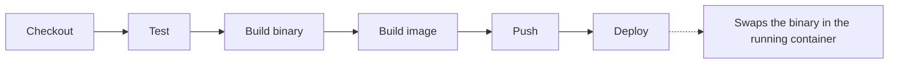
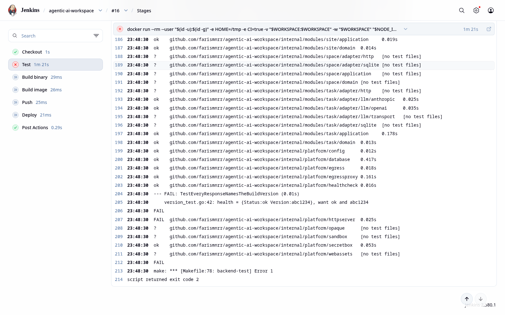

# Build, deploy and CI/CD

How the app is packed into an image, how a fix reaches the running app in seconds, and the Jenkins pipeline that does both.

## At a glance

| Part | What it does | File |
| --- | --- | --- |
| Image | Packs the app into one small image | [`Dockerfile`](../Dockerfile) |
| Hot swap | Replaces the binary in the running container, with no rebuild | [`scripts/deploy-binary.sh`](../scripts/deploy-binary.sh) |
| Pipeline | Tests, builds, pushes and deploys, in Jenkins | [`Jenkinsfile`](../Jenkinsfile) |



What you need:

- Git
- Docker 29
- Go 1.27.2, only to build the binary yourself (the image build needs Docker alone)
- Jenkins 2.580.1, running in Docker with a `docker:dind` daemon

## Build the image

The Dockerfile has three stages:

| Stage | Base image | Job |
| --- | --- | --- |
| `web` | `node:24-bookworm-slim` | Build the Svelte web app |
| `server` | `golang:1.27.2-bookworm` | Build one static binary (`CGO_ENABLED=0`) with the web app inside |
| final | `distroless/static-debian12:nonroot` | Hold the binary, nothing else |

Build it, run it, and check the version:

```bash
docker build --build-arg VERSION=1.0.0 -t ghcr.io/farismnrr/agentic-ai-workspace:1.0.0 .
docker run --rm -d -p 8080:8081 ghcr.io/farismnrr/agentic-ai-workspace:1.0.0

curl -si http://localhost:8080/ | grep -i x-app-version   # X-App-Version: 1.0.0
curl -s  http://localhost:8080/api/health                 # {"status":"ok","version":"1.0.0"}
```

- The host needs Docker only, not Go.
- The image listens on port 8081 by default, which is why the example maps `8080:8081`.

### Version

- **Default:** `var version = "dev"` in `cmd/workspace/main.go`.
- **How it is set:** the build overrides it with `-ldflags "-X main.version=<version>"`.
- **How you pass it:** `--build-arg VERSION=...` to Docker, or `VERSION=...` to `make backend-build`.
- **Where you see it:** the `X-App-Version` header on `GET /`, and `version` in the body of `GET /api/health`.

### Why distroless

- It is about 2 MB and runs as a non-root user (65532).
- It has no shell and no package manager, so there is less to attack or patch.
- `scratch` is smaller, but it has no CA certificates and no non-root user. The app makes HTTPS calls, so it needs both.
- `alpine` adds a shell and musl, and a static binary uses neither.
- The health check runs the binary itself (`agentic-ai-workspace healthcheck`), so the image needs no curl.

### Image size

```text
IMAGE                                                DISK USAGE   CONTENT SIZE
ghcr.io/farismnrr/agentic-ai-workspace:sha-b6e2744         41MB         11.5MB
```

- The base is about 2 MB. The rest is one binary layer (23.2 MB).
- That binary holds the Go runtime, Fiber, pure-Go SQLite, the Docker client and the whole web app.
- `-s -w` already strips debug symbols, so nothing big is left to cut.

## Swap the binary without a rebuild

To ship a fix, replace the binary on the host and restart the container. You don't rebuild the image or remove the container. [`scripts/deploy-binary.sh`](../scripts/deploy-binary.sh) does it for you.

### How it works

- The binary lives in a host folder, not in the image.
- The container mounts that folder read-only at `/opt/app` and runs `/opt/app/agentic-ai-workspace`.
- The script reads its settings from environment variables:

| Meaning | Variable | Default |
| --- | --- | --- |
| Host folder that holds the binary | `DEPLOY_DIR` | `/var/jenkins_home/deploy/agentic-ai-workspace` |
| Container name | `CONTAINER` | `agentic-ai-workspace-prod` |
| Port published on the host | `HOST_PORT` | `8080` |

### First run

This creates the container. The production container sets `PORT=8080`, so it maps `8080:8080`.

```bash
docker run -d --name agentic-ai-workspace-prod --restart unless-stopped \
  -p 8080:8080 -e PORT=8080 \
  -v /var/jenkins_home/deploy/agentic-ai-workspace:/opt/app:ro \
  -v agentic-ai-workspace-prod-data:/data \
  --entrypoint /opt/app/agentic-ai-workspace \
  ghcr.io/farismnrr/agentic-ai-workspace:sha-<commit>
```

### Every fix after that

Do the same steps by hand. `DIR` is the host folder from the table above.

```bash
DIR=/var/jenkins_home/deploy/agentic-ai-workspace

make backend-build VERSION=<new>
cp bin/agentic-ai-workspace "$DIR/agentic-ai-workspace.new"
chmod 755 "$DIR/agentic-ai-workspace.new"
cp "$DIR/agentic-ai-workspace" "$DIR/agentic-ai-workspace.prev"    # keep for rollback
mv -f "$DIR/agentic-ai-workspace.new" "$DIR/agentic-ai-workspace"  # atomic swap
docker restart -t 5 agentic-ai-workspace-prod
```

### Result

Output from Jenkins build #15. The version changed in about 2 seconds, with no image rebuild:

```text
before swap:
X-App-Version: b6e2744-b14
{"status":"ok","version":"b6e2744-b14"}
after swap (back in 2s, no image rebuild):
X-App-Version: b6e2744-b15
{"status":"ok","version":"b6e2744-b15"}
```


### Why this approach

A hotfix must be fast and easy to undo.

- **Fast:** a file rename plus a restart takes about 2 seconds, with no image rebuild.
- **Safe:** the container keeps its ports, volumes and restart policy.
- **Easy to undo:** rolling back is renaming the old file back.
- **Folder mount, not file mount:** a single-file mount keeps pointing at the old file after a rename.
- **Survives recreates:** unlike `docker cp`, the binary survives a container recreate and is never overwritten while it runs.
- **Trade-off:** the binary can be newer than the image tag, so each build reports its own version.

## CI pipelines

### GitHub workflows

GitHub Fast and Full protect `dev` and the release merge. Their required checks are:

| Workflow | Checks |
| --- | --- |
| Fast | Guardrails and Go unit tests gate the app image and conditional sandbox image builds |
| Full | Frontend checks, Go lint, build, smoke, black-box, browser, Docker isolation, and race checks |

Fast runs on pushes and pull requests to `dev`; only pushes publish images.
Full is manual and merges only after every full-suite check passes.

### When a check fails

- A failed check blocks image publishing and the release merge.
- A failed image smoke check means that image is not shipped.
- A failed browser or isolation check blocks Full; fix the behavior or report
  the exact failure before retrying the workflow.
- Documentation-only changes skip Fast because its path filters exclude them.

### Test folders

| Folder | Contents |
| --- | --- |
| `test/blackbox/` | Bash HTTP and MCP scenarios against the built binary |
| `test/e2e/` | Playwright TypeScript flows, started by a Bash runner |
| `test/smoke/` | Binary, image, sandbox, and volume isolation scenarios |
| `test/lib/` | Shared Bash startup, HTTP, MCP, and assertion functions |
| `test/fixtures/` | Static inputs for scenarios |
| `test/go/` | Go tests, shared harness, and retained-test registry |

`make blackbox` runs the black-box scenarios. `make smoke`, `make e2e`, and
`make registry-check` run their named suites.

The guardrail script skips content and size checks inside `test/` and
`scripts/`. It still checks test placement and program imports from `test/`.
ShellCheck, Go lint, and frontend lint remain separate checks.

### Jenkins pipeline

The Jenkinsfile runs six stages, in this order:

| Stage | What it does |
| --- | --- |
| Checkout | Clone the branch in `BRANCH` (default `main`). The version is `<commit>-b<build number>`. |
| Test | Frontend checks, then guardrails, Go lint and `go test`. A failure stops the pipeline before anything is built. |
| Build binary | Build with the version in `-ldflags`, then smoke-test the binary. |
| Build image | Build the app image and the sandbox image, both tagged `sha-<commit>`, and smoke-test each. |
| Push | Log in to GHCR with the `ghcr-credentials` Jenkins credential and push both images. Only `main` also moves `latest`. |
| Deploy | Run `scripts/deploy-binary.sh` to swap the binary (see [Swap the binary](#swap-the-binary-without-a-rebuild)). |

### How it runs

- **Agent:** the Jenkins container has only Git, curl and Docker.
- **Node and Go:** they run in short-lived containers that mount the workspace. That works because the dind daemon shares `/var/jenkins_home` with Jenkins.
- **One build at a time:** concurrent builds are off, and a build stops after 45 minutes.
- **No secret in the file:** the registry token comes from the Jenkins credential through `withCredentials`, and the pipeline logs out of GHCR at the end.

### Proof

All stages green in build #15:


When a test fails, nothing after it runs. Build #16 ran a branch with one test broken on purpose:

- `go test` failed and the Test stage turned red.
- Build, Push and Deploy were skipped.
- The running app stayed on the previous version.



### Rollback

If the Deploy stage fails, the script rolls back on its own:

1. Before the swap, it copies the running binary to `.prev`.
2. After the restart, it waits up to 30 seconds for `/api/health` to report the new version.
3. If that doesn't happen, it prints the container logs, puts `.prev` back and restarts.
4. It exits with an error, so the build turns red.

What stays safe:

- The container is never removed, so the last good binary keeps running.
- If Test, Build or Push fails, the running app is never touched.
- Older builds stay in GHCR as `sha-<commit>`. To go back further, run the job on an older commit.
