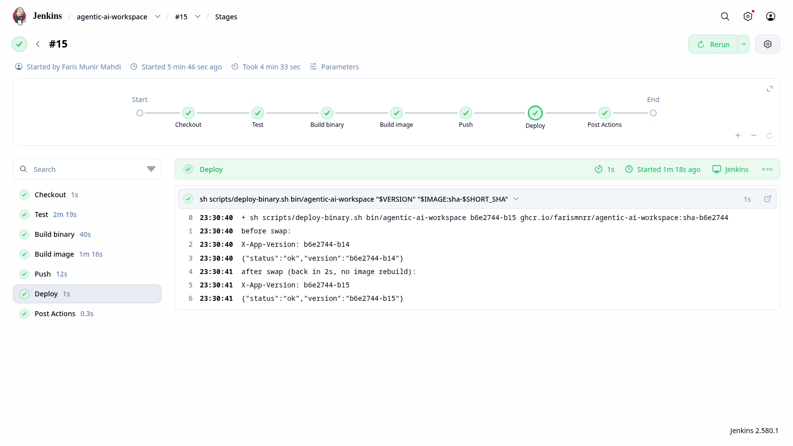
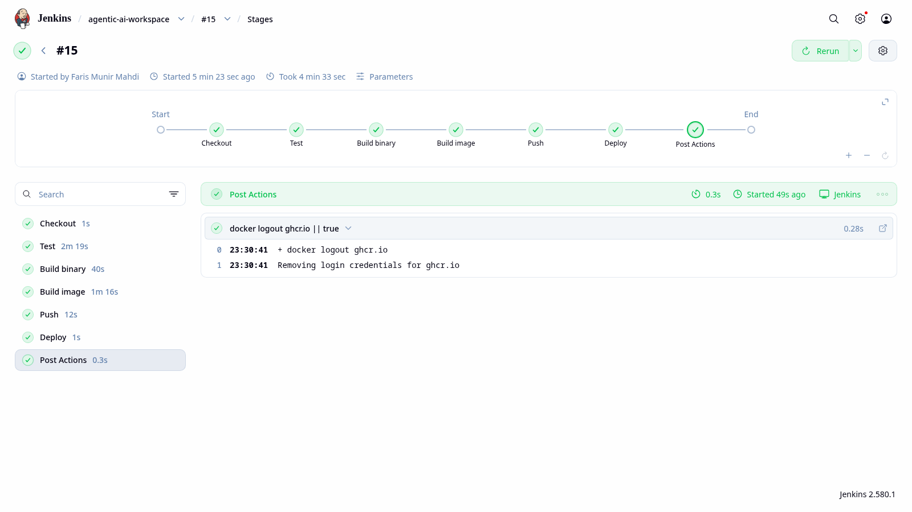

# Build, deploy and CI/CD

This page covers three things: building the image, swapping in a fixed binary without a rebuild, and the Jenkins pipeline that does both.

Tools used: Git, Docker 29, Go 1.27.2, and Jenkins 2.580.1 running in Docker with a `docker:dind` daemon.

## 1. Build

The [Dockerfile](../Dockerfile) has three stages:

| Stage | Base image | Job |
| --- | --- | --- |
| `web` | `node:24` | Build the Svelte web app |
| `server` | `golang:1.27.2` | Build one static binary (`CGO_ENABLED=0`) with the web app inside |
| final | `distroless/static-debian12:nonroot` | Hold the binary, nothing else |

Build and run:

```bash
docker build --build-arg VERSION=1.0.0 -t ghcr.io/farismnrr/agentic-ai-workspace:1.0.0 .
docker run --rm -d -p 8080:8081 ghcr.io/farismnrr/agentic-ai-workspace:1.0.0

curl -si http://localhost:8080/ | grep -i x-app-version   # X-App-Version: 1.0.0
curl -s  http://localhost:8080/api/health                 # {"status":"ok","version":"1.0.0"}
```

The host needs Docker only, not Go.

### Version

`cmd/workspace/main.go` has `var version = "dev"`. The build overrides it with `-ldflags "-X main.version=<version>"`. Pass it as `--build-arg VERSION=...` to Docker, or `VERSION=...` to `make backend-build`.

`GET /` returns the web app's HTML, so the version comes back in the `X-App-Version` header. `GET /api/health` also returns it in the body.

### Why distroless

- It is about 2 MB and runs as a non-root user (65532).
- It has no shell and no package manager, so there is less to attack or patch.
- `scratch` is smaller, but it has no CA certificates and no non-root user. The app makes HTTPS calls, so it needs both.
- `alpine` adds a shell and musl, and a static binary uses neither.

The health check runs the binary itself (`agentic-ai-workspace healthcheck`), so the image needs no curl.

### Image size

```text
IMAGE                                                DISK USAGE   CONTENT SIZE
ghcr.io/farismnrr/agentic-ai-workspace:sha-b6e2744         41MB         11.5MB
```

The base is about 2 MB. The rest is one binary layer (23.2 MB). That binary holds the Go runtime, Fiber, pure-Go SQLite, the Docker client and the whole web app. `-s -w` already strips debug symbols, so nothing big is left to cut.

## 2. Swap the binary without a rebuild

The binary lives in a host folder, not in the image. The container mounts that folder read-only at `/opt/app` and runs `/opt/app/agentic-ai-workspace`.

To ship a fix, you replace the file on the host and restart the container. You don't rebuild the image or remove the container. [`scripts/deploy-binary.sh`](../scripts/deploy-binary.sh) does it for you.

First run, which creates the container:

```bash
docker run -d --name agentic-ai-workspace-prod --restart unless-stopped \
  -p 8080:8080 -e PORT=8080 \
  -v /var/jenkins_home/deploy/agentic-ai-workspace:/opt/app:ro \
  -v agentic-ai-workspace-prod-data:/data \
  --entrypoint /opt/app/agentic-ai-workspace \
  ghcr.io/farismnrr/agentic-ai-workspace:sha-b6e2744
```

Every fix after that:

```bash
make backend-build VERSION=<new>
cp bin/agentic-ai-workspace "$DIR/agentic-ai-workspace.new"
chmod 755 "$DIR/agentic-ai-workspace.new"
cp "$DIR/agentic-ai-workspace" "$DIR/agentic-ai-workspace.prev"    # keep for rollback
mv -f "$DIR/agentic-ai-workspace.new" "$DIR/agentic-ai-workspace"  # atomic swap
docker restart -t 5 agentic-ai-workspace-prod
```

Output from Jenkins build #15:

```text
before swap:
X-App-Version: b6e2744-b14
{"status":"ok","version":"b6e2744-b14"}
after swap (back in 2s, no image rebuild):
X-App-Version: b6e2744-b15
{"status":"ok","version":"b6e2744-b15"}
```



### Why this approach

A hotfix has to be fast and easy to undo. Here a swap is a file rename plus a restart, about 2 seconds of downtime. The container keeps its ports, volumes and restart policy. Rollback means renaming the old file back.

We mount the folder, not the single file. A single-file mount follows the old file even after you rename a new one over it, so the container would not see the fix. Compared with `docker cp`, the binary survives if the container is recreated, and you never overwrite a file that is running.

The trade-off: the running binary can be newer than the image tag. That is why each binary reports its own version.

## 3. Jenkins pipeline

The [Jenkinsfile](../Jenkinsfile) runs these stages in order:

| Stage | What it does |
| --- | --- |
| Checkout | Clone the branch in `BRANCH` (default `main`). Version is `<commit>-b<build number>`. |
| Test | Frontend checks, then Go lint and `go test`. A failure stops the pipeline before anything is built. |
| Build binary | Build with the version in `-ldflags`, then smoke-test the binary. |
| Build image | `docker build --build-arg VERSION=...` tagged `sha-<commit>`, then smoke-test it. |
| Push | Log in to GHCR with the `ghcr-credentials` Jenkins credential and push. Only `main` also moves `latest`. |
| Deploy | Run `scripts/deploy-binary.sh` to swap the binary (section 2). |

The Jenkins container has only Git, curl and Docker. Node and Go run in short-lived containers that mount the workspace. That works because the dind daemon shares `/var/jenkins_home` with Jenkins.

No secret is in the Jenkinsfile. The registry token comes from the Jenkins credential through `withCredentials`.



### Rollback

If the Deploy stage fails:

1. Before the swap, the script copies the running binary to `.prev`.
2. After the restart, it waits up to 30 seconds for `/api/health` to report the new version.
3. If that doesn't happen, it prints the container logs, puts `.prev` back and restarts.
4. It exits with an error, so the build turns red.

The container is never removed, so the last good binary keeps running. Older builds stay in GHCR as `sha-<commit>`. To go back further, run the job on an older commit. If Test, Build or Push fails, the running app is never touched.
