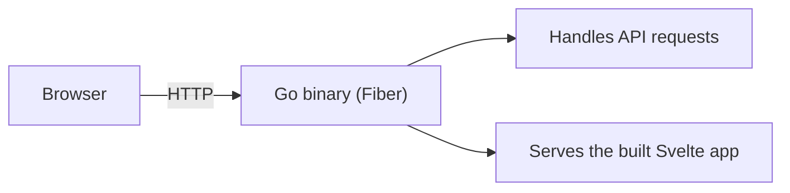
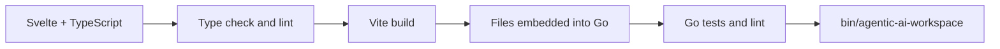

# System design

How the app is put together, in short. The goal: easy to run, easy to grow, never one tangled codebase.

## At a glance

| Part | What it is |
| --- | --- |
| Program | One Go binary, one process, one port |
| Web app | Svelte, built once and embedded in the binary |
| Data | SQLite under `DATA_DIR` |
| AI work | Short-lived Docker containers, started through the Docker socket |
| AI models | Called over HTTPS with the person's own keys |

## How it runs



- **One executable** to deploy and one process to monitor.
- **One public port** to configure.
- **No Node.js** on the server: the frontend is compiled during the build.

## How a build works



Run `make build`. It verifies first, then builds the binary.

## Code layout

```text
cmd/workspace/            program entry point, stays small
internal/bootstrap/       connects the pieces
internal/modules/<feature>/
  domain/                 business rules and types
  application/            use cases and the interfaces they need
  adapter/                HTTP, database and other implementations
internal/platform/        config, egress, HTTP server, embedded web app
```

- **Dependencies point inward:** `adapter -> application -> domain`.
- **A domain rule never knows** which HTTP framework or database is used. That keeps it easy to test and to replace.
- **Platform code** holds technical details only, never business rules.
- **A feature creates only the layers it needs.** Empty folders do not help.
- **Egress grants** (`modules/egressgrant`) will let a person approve an extra HTTPS host for one task.
  The domain rules, use cases, SQLite store and migration 052 exist; nothing is connected to the proxy, the
  sandbox or any route, and the feature is off.
- **Project Env** (`modules/env`) owns project variables and encrypted storage.
  `modules/dbconn` stores one external database connection, tests it, and can
  provision isolated PostgreSQL, MySQL and MongoDB resources through
  per-kind application ports and adapters. Shared settings are keyed by kind;
  passwords and certificate material are encrypted. `POSTGRES_ADMIN_URL` is
  the fallback when no saved PostgreSQL settings exist.
  Migration 045 adds the connection's `managed` flag. Projects choose SQLite,
  PostgreSQL, MySQL or MongoDB. SQL kinds use `DATABASE_URL`; MongoDB uses
  `MONGODB_URL`. Managed project Env receives `DATABASE_SSL_CA` when present.
  Administrator client certificates and keys stay in the server provisioner;
  project app mutual TLS is unsupported. Apps needing their own client
  certificate must set their own Env values. MySQL users are scoped to their
  project's database; MongoDB users receive `readWrite` on theirs. Detaching
  removes the managed connection and Env values without dropping remote data.

### Frontend

```text
web/src/
  app/                    shell, router
  features/<feature>/     one feature's screens and logic
  shared/                 UI and logic used by two or more features
```

- Strict TypeScript everywhere.
- daisyUI is the component layer. Tailwind covers layout and small tweaks.
- Features never import other features. Shared code goes in `shared/`.

## Accounts and connectors

The binary hosts its own sign-in and an OAuth 2.1 server, so AI apps can connect without any extra service.

- **Accounts:** email and password with a cookie session. Data lives in SQLite, using a pure-Go driver so the binary stays static. Accounts have `admin` or `user` roles; new accounts default to `user`.
- **Server settings:** only admins can read full shared database settings or save them. PostgreSQL, MySQL and MongoDB settings are stored separately; other signed-in users see only which kinds are configured. Per-user providers, integrations, preferences and project settings remain owner-scoped.
- **Spaces:** each space is an endpoint an AI app can call. The first, `coding`, lets it read, search, change and run things in that app's own project.
- **Isolation:** every call resolves to one person's project. Nobody can reach another person's files, and two apps never share a folder.
- **Tokens:** stored hashed and tied to one space. A replayed code or refresh token revokes the whole connection.

Each tool has a switch the person controls in Settings. A call must pass the switch, then the token's scope, and is always logged. Edits save the old content first, which is what Undo restores.

Project files use owner-scoped `/api/projects/:id/files` routes. The upload
endpoint, `POST /api/projects/:id/uploads`, accepts one multipart file per
request and stores it under `uploads/`. The authenticated request hook raises
Fiber's body limit for this endpoint only. Raw files use confined, ranged
serving. Uploads have no per-project storage quota.

## The sandbox

Tasks, commands and web apps run in one throwaway Docker container per run.

| Limit | How |
| --- | --- |
| Files | Only that person's project folder is visible |
| Network | No direct network. Package registries and the project's saved database only, through a proxy |
| System | Read-only root, no extra privileges, memory, CPU and process limits |
| Capacity | `MAX_SANDBOXES` runs at once. A run stops if its folder passes 2 GiB |

- **Toolchains** (Python, Node.js, Go, Rust, Java and more) live in the image, so nothing downloads per person.
- **Browser:** a headless Chromium in the image takes screenshots of a running site. It runs in its own container with no network.
- **Agent login screenshots:** a separate tool can submit selected login/logout forms. Project Env secrets reach the short-lived browser only through stdin; its cookie jar is scoped to one task and expires after 30 minutes idle or four hours total.
- **Docker down?** Checks fail with a plain reason and nothing else breaks.
- **Not covered:** hard disk quotas, and the host kernel and Docker daemon that every container shares.
- **Docker socket:** whoever controls it controls the host. Docker rootless mode is the recommended mitigation.

The server's `platform/egress` checks outgoing addresses when it dials them.
`PrivateAllowed` is used for an owner's database connection test and shared
PostgreSQL provisioning: it allows public, private and loopback addresses, but
blocks link-local, special ranges and the server's own port. Sandbox containers
remain network-disabled.

The egress proxy also tunnels exact `host:port` targets per run: the database an
admin saved in Settings, for a project whose connection was created from it, and
the model gateway on this computer that the project's owner chose.
The sandbox opens each port on its own loopback and the proxy dials the target
with `PrivateAllowed`, never the server's own port.

Web apps the AI starts use the same sandbox. See [sites.md](./sites.md).

## The agent

- **One thread per message.** There is no separate chat. The AI decides whether to answer or to plan and work.
- **Approvals.** Reading is automatic. Changing files or running commands waits for your yes, unless you turned on Skip approvals.
- **Switches win.** A tool that is off is never offered to the model and never run.
- **Pause and resume.** The conversation is stored, so a task can wait for you and continue later.
- **Project documents.** Task plans, requirements and research are exported into `project-notes/`. New tasks get an index reference; documents are loaded through existing file tools.
- **Task archive.** Archive and delete controls live in task lists. Archived
  tasks leave active lists and counts, but retain their records and pin. Their
  pages are read-only; restore is available in Archive. Permanent deletion
  stops a running task, removes its screenshots and task documents, deletes
  its records, then rebuilds the project document index. Shared uploads remain.
- **Long input.** Messages over 12,000 characters become an exact text document, a manifest and readable parts. The thread holds a preview and download link. Request-body limits still apply.
- **Task result.** The receipt summarizes checks after the last change.
  Verified checks are distinct from checks the AI only claims to have run.
- **Checks.** A project's checks live in `.workspace/tasks.json`. The AI's tools can never read or write that file.
- **GitHub.** Each person connects their own account. Commands get only their token. Web apps never do.

## Your own AI plan

- **How:** the provider's own program (Claude Code or Codex) runs in the sandbox image, once per turn, in the project's folder. The app reads what it prints and records the steps.
- **Sign-in:** the program signs in on the provider's page. The app never reads or stores the token. It only keeps the program's folder per person and removes it with the account.
- **Network:** the program reaches only its provider's hosts, through the same per-person proxy socket.
- **Checks:** commands the program ran count like the app's own, so
  "Proven to work" still comes from the app.

## Models

- **Providers:** Anthropic, OpenAI, Gemini, or an OpenAI-compatible gateway on the same computer, such as 9router.
- **Keys:** stored encrypted. Hosted providers can reach only public addresses. Gateways only this computer.
- **Gateways:** the model list is re-read on its own, at most every 30 seconds, so a provider added behind it appears without a click.
- **Model and effort:** app tasks resolve current orchestrator settings at each run. Assigned teammate jobs retain their selection on resume. Explicit model or effort choices from the API stay pinned.
- **Provider changes:** a different vendor program starts a fresh session with task context. A gateway can say which effort levels each model takes.
- **Context window:** the size you chose, else the size the provider reports, else a default. Near the limit the AI summarizes its notes and keeps going.
- **Limits:** 40 model turns and 15 minutes per run. One task at a time per project. Interrupted tasks can be continued.

## Data and updates

- **Export and delete:** your data downloads as one zip. Permanent task deletion removes task records and task-specific files; project-shared uploads remain. Account deletion removes everything tied to the account.
- **Live updates:** pages follow changes over server-sent events and fall back to a slow poll.
- **Rate limits:** sign-in, sign-up and OAuth endpoints are limited per visitor. Wrong guesses never lock you out.
- **Database changes:** only through numbered migration files. Applied files are checksummed and never edited.

## Quality and release

`make verify` runs every check:

1. Repository guardrails.
2. Svelte and TypeScript checks.
3. Frontend lint and production build.
4. Go module check and tests.
5. Strict Go lint and architecture rules.

`make e2e-sites` also tests a private site in a real browser. It needs Docker and Playwright and is not part of `make verify`.

Rules in the code: source files stay under 200 lines (documentation is exempt), and functions have size and complexity limits.

Work happens on `dev`. Two GitHub Actions workflows run the same checks:

| Workflow | When | What it does |
| --- | --- | --- |
| **Fast** | Every push to `dev` | Verifies, builds the binary and image, smoke-tests both, publishes the `dev` image |
| **Full** | Started by hand from `dev` | Repeats everything from a clean checkout, merges `dev` into `main`, publishes `latest`, then deploys it to production |

For the Jenkins pipeline and hotfix deploys, see [devops.md](./devops.md).

## Deployment

- Run the image `ghcr.io/farismnrr/agentic-ai-workspace` with `compose.latest.yaml` (or `compose.dev.yaml`).
- The Docker socket is mounted so checks can run in containers.
- There is no Node.js runtime, frontend server or extra port to deploy.

Steps and settings: [deployment.md](./deployment.md).
